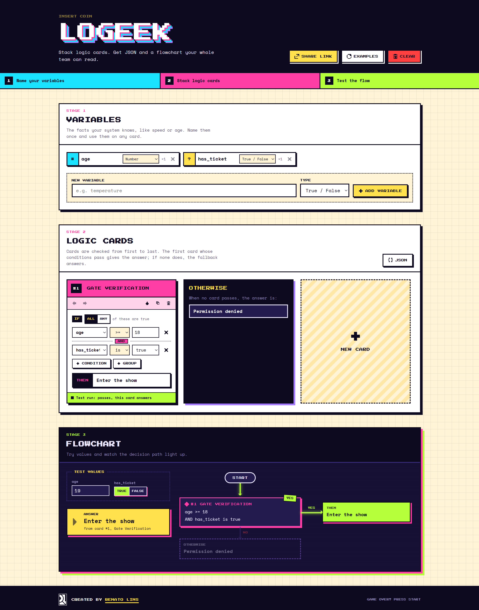

# Logeek

**Stack logic cards. Get JSON and a flowchart your whole team can read.**




Logeek is a visual rule builder with an 80s arcade look. Name the facts a
system knows, stack cards like `age >= 18 AND has_ticket is true`, and get
two things back, live: **JSON a rule engine can run** and **a flowchart a
person can follow**. Type test values and the path the decision takes lights
up.

No account, no server, no install for whoever opens the link.

## Why it exists

Business rules (who sees the promo, when a ride unlocks, which order gets
flagged) are usually argued about in chat and then rewritten by a developer
who was not in the room. Logeek puts the rule itself on the table:

| Who | What they get |
| --- | --- |
| Product and business | Build and read the rules in plain words, no code |
| Developers | The same rules as JSON, ready for a rule engine |
| QA and support | Type values, see which card answers, in seconds |
| Everyone | One link that opens the exact same board |

## How it works

1. **Name your variables.** Number, text or true/false: `age`, `country`,
   `has_ticket`.
2. **Stack logic cards.** Each card says IF all (AND) or any (OR) of its
   conditions hold, THEN an answer. Cards are checked top to bottom; the first
   that passes answers, and **Otherwise** covers the rest.
3. **Test the flow.** Type values and watch the flowchart light the path,
   while every card shows whether it passed.

## Features

- **Variables** of three types: number, text and true/false. Rename in place;
  a variable still in use cannot be deleted by accident.
- **Logic cards** with nested groups:
  `hasTicket is true OR (country is "BR" AND coins > 10)`.
- **Operators per type**: `>`, `>=`, `<`, `<=`, `=`, `≠` for numbers; `is`,
  `is not`, `contains` for text; `is`, `is not` for true/false.
- **Ordered decisions**: first passing card answers, **Otherwise** answers
  when none does.
- **Live flowchart**: the deck drawn as a decision chain (YES to the answer,
  NO to the next card).
- **Test run**: type values per variable; the chart lights the path, each card
  shows its result and the answer stays in view.
- **JSON both ways**: one dialog turns cards into JSON, or rebuilds cards from
  pasted JSON (with Undo).
- **Two JSON formats**: the readable Logeek format, or a single
  [JsonLogic](https://jsonlogic.com) rule any JsonLogic library can run.
  Pretty or compact, with Copy and Download.
- **Share link**: the whole board (cards, variables, test values) packed into
  the URL. Nothing is uploaded.
- **Autosave** in the browser, with Undo for removing a card, clearing the
  board or loading a link.
- **Examples** on demand: a new board starts empty, one click loads three
  sample cards.
- **Colourful brutalism**: thick borders, hard shadows, pixel fonts, CRT
  screens. Keyboard friendly and labelled for screen readers.

## The output

The board in the screenshot, in the Logeek format:

```json
{
  "variables": { "age": "number", "has_ticket": "boolean" },
  "decisions": [
    {
      "name": "Gate Verification",
      "if": {
        "all": [
          { "variable": "age", "operator": ">=", "value": 18 },
          { "variable": "has_ticket", "operator": "==", "value": true }
        ]
      },
      "then": "Enter the show"
    }
  ],
  "otherwise": "Permission denied"
}
```

The same logic as JsonLogic, one `if` chain ending in the fallback:

```json
{
  "if": [
    { "and": [{ ">=": [{ "var": "age" }, 18] }, { "==": [{ "var": "has_ticket" }, true] }] },
    "Enter the show",
    "Permission denied"
  ]
}
```

```js
jsonLogic.apply(rule, { age: 19, has_ticket: true }); // "Enter the show"
```

## Under the hood

- **Frontend only.** The board lives in localStorage and travels in the URL
  fragment (`#board=...`), which browsers never send to a server. Hosting is
  a folder of static files.
- **One gate for untrusted input.** Share links, saved storage and imported
  JSON all pass the same validator, which checks shape and size limits and
  rebuilds every id before anything reaches the store.
- **Pure logic core.** Evaluation, both exporters, the importer and the
  share codec are plain functions with no React in them, each with its own
  tests.
- **Strict layering.** `pages` use `domain`, `domain` uses `shared`, all use
  `lib`. Generic components never know about logic cards.
- **Quality gates.** TypeScript strict, ESLint with zero warnings, Prettier,
  and a pre-commit hook that runs lint, type check and tests.

The full picture: [docs/ARCHITECTURE.md](docs/ARCHITECTURE.md).

## Run it

Requirements: Node 24 (see `.nvmrc`) and npm.

```bash
npm ci
npm run dev
```

Open the address Vite prints (usually http://localhost:5173) and press
**Examples** to start from a sample board.

| Script | What it does |
| --- | --- |
| `npm run dev` | Web app with hot reload |
| `npm test` | Every test once (Vitest and Testing Library) |
| `npm run type-check` | TypeScript check |
| `npm run lint` | ESLint, zero warnings allowed |
| `npm run format` | Prettier |
| `npm run build` | Type check and production build into `dist` |
| `npm run preview` | Serves the production build |

## Project structure

```
src/
  pages/              the builder screen
  domain/             logic cards: models, pure logic, store, hooks, components
  shared/             generic UI: Button, Panel, Modal, Toast, PixelIcon
  lib/                pure helpers: ids, base64url, JSON tokens
  styles/             theme tokens, mixins, global styles
docs/
  USER-GUIDE.md       how to use the app, stage by stage
  ARCHITECTURE.md     big picture, data flow, model, files, stack
  decisions/          one file per architecture decision
  print/              screenshots
.claude/              rules, hooks, agents and skills for AI assistants
```

## Documentation

| I want to | Read |
| --- | --- |
| Use every part of the app | [User guide](docs/USER-GUIDE.md) |
| Understand how the code fits together | [Architecture](docs/ARCHITECTURE.md) |
| Know why it has no backend | [0001: frontend only](docs/decisions/0001-frontend-only.md) |
| Know why it is one app at the root | [0002: single app at root](docs/decisions/0002-single-app-at-root.md) |
| See what changed | [Changelog](CHANGELOG.md) |
| Change the code with an AI assistant | [`AGENTS.md`](AGENTS.md), then `.claude/rules/palace.md` |

## Credits

Created by [Renato Lins](https://www.linkedin.com/in/renatolinsdigital/).
