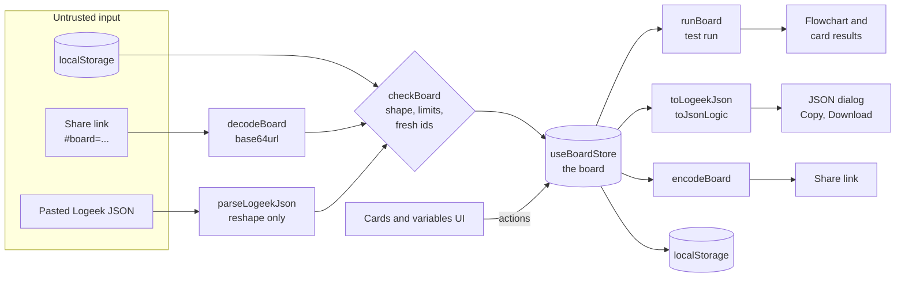

# Architecture

How Logeek is put together, in the order you need it: the big picture, the
data model, how data moves, where each piece lives, and the stack. The rules
for changing the code live in `.claude/rules/palace.md` and its rooms.

## The big picture

Logeek is a single React app with no backend. Everything a person builds is
one **board**, held in a Zustand store. Every view of the board (the cards,
the flowchart, the test run, the JSON) is computed from the store by pure
functions, so there is one source of truth and nothing to keep in sync.



Three ideas carry the design:

1. **One gate.** Saved storage, share links and imported JSON are all
   untrusted. Each passes `checkBoard` (`domain/logic/boardCodec.ts`), which
   checks the shape and the size limits and rebuilds every id, before it can
   reach the store.
2. **Pure logic.** Evaluation, both exporters, the importer and the codec are
   plain TypeScript in `domain/logic/`, with no React. They are tested on
   their own.
3. **No server.** A share link puts the board in the URL fragment, which
   browsers never send to a server. See
   [0001](decisions/0001-frontend-only.md).

## The board

```ts
Board      = { variables: Variable[], cards: LogicCard[], otherwise: string }
Variable   = { id, name, type: 'number' | 'text' | 'boolean', sample }
LogicCard  = { id, title, color, when: ConditionGroup, then }
ConditionGroup = { id, kind: 'group', match: 'all' | 'any', items: (Condition | ConditionGroup)[] }
Condition  = { id, kind: 'condition', variableId, operator, value }
```

The full types are in `src/domain/models/logic.model.ts`.

**Evaluation** (`domain/logic/evaluate.ts`, `runBoard`): walk the cards in
order; the first whose `when` group passes answers with its `then`; if none
passes, `otherwise` answers. The flowchart, the test run and the JsonLogic
`if` chain all follow this same order.

Rules worth knowing:

- An empty `all` group passes and an empty `any` group fails, as in logic.
- Condition values and test values (`sample`) are stored as the text the
  person typed, and read through the variable's type. A half-typed number
  never breaks the board: a value that cannot be read never passes.
- Changing a variable's type resets every condition that reads it.
- A variable that a condition still reads cannot be removed.

## Output formats

| Format | Shape | Goes back in? |
| --- | --- | --- |
| Logeek | `{ variables: { name: type }, decisions: [{ name, if, then }], otherwise }` where `if` is `{ all: [...] }` or `{ any: [...] }` of `{ variable, operator, value }` and nested groups | Yes, through JSON to cards |
| JsonLogic | One rule: `{ "if": [condition1, answer1, ..., otherwise] }`, using `and`, `or`, the comparison operators and `in` for contains | No: it carries no card names or variable types |

Both are a contract with whoever copies them: a change to their shape is a
major version.

A **share link** carries neither format. It carries the board itself (ids,
card colours, test values, nested groups) as JSON, base64url encoded. That is
why a link restores colours and test values and an import does not.

## Where things live

```
src/
  main.tsx                     mounts the app
  pages/BuilderPage/           the one screen: header, three stages, footer
  domain/                      everything that knows about logic cards
    models/                    Board, Variable, LogicCard, Condition, ConditionGroup
    logic/                     pure functions (table below)
    store/                     useBoardStore (state and actions), useBoard (selector)
    hooks/                     useLoadSharedBoard (a link on load), useCopyShareLink (build and copy one)
    components/                the panels, cards and dialogs (table below)
  shared/components/           generic UI: Button, Panel, SegmentedControl, Modal, Toast, JsonCode, PixelIcon
  lib/                         helpers: createId, classNames, base64Url, isRecord, jsonTokens
  styles/                      theme tokens, mixins, global styles
  test/setup.ts                Vitest and Testing Library setup
```

Imports point downwards only: `pages` use `domain`, `domain` uses `shared`,
and all of them use `lib`. `shared` knows nothing about logic cards.

### Logic (`src/domain/logic/`)

| File | Does |
| --- | --- |
| `operators.ts` | Operators allowed per type, defaults, `parseTypedValue` |
| `evaluate.ts` | `runBoard`: which card answers for the current test values |
| `describe.ts` | Plain-language text for conditions, used by the flowchart |
| `tree.ts` | Immutable helpers to add, update and remove nodes in a group tree |
| `exportJson.ts` | `toLogeekJson`, `toJsonLogic`, `formatBoardJson` |
| `importJson.ts` | `parseLogeekJson`: Logeek JSON to the board shape |
| `boardCodec.ts` | `checkBoard` (the gate), `encodeBoard`, `decodeBoard` |
| `examples.ts` | The three example cards |

### Components (`src/domain/components/`)

| Component | On screen |
| --- | --- |
| `AppHeader` | Logo and the Share link, Examples and Clear buttons |
| `VariablesPanel`, `VariableChip` | Stage 1: the variable list and the add form |
| `CardDeck`, `LogicCard` | Stage 2: the cards, the Otherwise card, New card |
| `ConditionGroupEditor`, `ConditionRow` | The IF part of a card, with nested groups |
| `JsonModal` | The JSON dialog, switching between the two below |
| `JsonExport` | Cards to JSON: format, layout, Copy, Download |
| `JsonImportForm` | JSON to cards: paste, check, load with Undo |
| `FlowchartPanel`, `TestRunInputs`, `Flowchart` | Stage 3: test values, the answer, the lit chart |
| `AppFooter` | Credits |

## Data and privacy

No personal data is stored, and nothing leaves the browser.

| Store | Holds | Why this store |
| --- | --- | --- |
| localStorage (`logeek-board`) | The current board and the JSON view settings | Survives reloads with no account and no server |
| URL fragment (`#board=...`) | A shared board | Sharing without uploading anything |

Saved storage passes the same `checkBoard` gate as a link: an old or edited
save that does not fit is dropped and the board starts empty.

`checkBoard` caps a board at 60 variables, 120 cards, 60 items per group,
groups nested 4 deep and 300 characters per text field, so a crafted link
cannot freeze the page.

## Testing

Tests sit beside the code they cover and run with Vitest and Testing
Library in jsdom.

| Test | Covers |
| --- | --- |
| `domain/logic/*.test.ts` | Evaluation, both exporters, the importer, the codec and its limits |
| `domain/store/useBoardStore.test.ts` | Store actions and their invariants |
| `pages/BuilderPage/BuilderPage.test.tsx` | The page as a person uses it, found by role and label |
| `lib/*.test.ts` | base64url and JSON tokens |
| `styles/stylesheets.test.ts` | Every stylesheet compiles without a Sass warning |

A pre-commit hook runs lint-staged, the type check and the tests.

## Stack

| Part | Choice | Installed version |
| --- | --- | --- |
| Runtime | Node.js | 24 |
| Language | TypeScript (strict) | 6.0.3 |
| Web app | React with Vite | React 19.3.1, Vite 8.3.7 |
| State | Zustand (with `persist`) | 5.1.0 |
| Styles | Sass (SCSS modules) | 1.108.1 |
| Fonts | `@fontsource` Press Start 2P, Space Mono | 5.3.0 |
| Tests | Vitest, Testing Library (React) | 5.1.0, 16.3.3 |
| Lint and format | ESLint, typescript-eslint, Prettier, Husky, lint-staged | 10.14.0, 8.72.2, 3.9.10, 9.1.7, 17.6.0 |

Held back: TypeScript stays on 6.0 because typescript-eslint 8.72 supports
TypeScript below 6.1 only. Move to 7 when typescript-eslint does.

## Decisions

Why things are the way they are, one file each, in
[decisions/](decisions/README.md).
