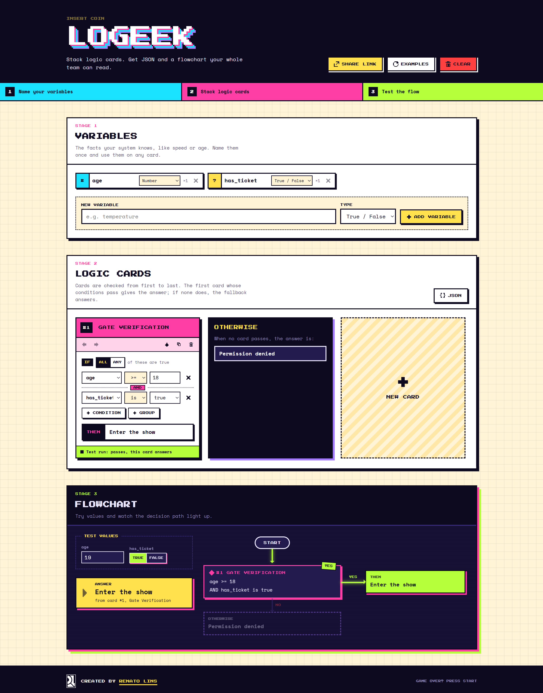

# User guide

Everything Logeek does, in the order you meet it on the page. The page has a
header and three stages: **1 Variables**, **2 Logic cards**, **3 Flowchart**.



## A two-minute tour

1. Press **Examples** in the header to load three sample cards.
2. In stage 3, change a test value. The flowchart lights the path the
   decision takes and the yellow **Answer** box says which card answered.
3. Back in stage 2, flip a card from **ALL** to **ANY**, or change a number,
   and watch the answer change.
4. Press **JSON** on the Logic cards panel to see the board as JSON.
5. Press **Share link** and paste the link to a teammate: it opens this exact
   board.

## Stage 1: Variables

Variables are the facts your system knows, such as `age` or `country`.

- **Add one**: type a name under **New variable**, pick a **Type**, press
  **Add variable**.
- **Types**: Number, Text, or True / False. The type decides which operators a
  condition can use.
- **Rename** by typing over the name on its chip, then Enter (Escape
  cancels). Every card follows.
- **Change type** from the chip. Conditions that read that variable reset,
  because their old values no longer fit, and a toast says how many.
- **Remove** with the X. The `×1` on the chip counts the conditions that read
  the variable; while it is above zero the X is disabled, so a card never
  loses a variable it needs.

## Stage 2: Logic cards

Each card is one decision: **IF** its conditions hold, **THEN** an answer.

- **New card**: the dashed tile at the end of the deck.
- **Title**: type in the coloured header.
- **IF ALL / ANY**: ALL means every condition must pass (AND), ANY means one
  is enough (OR).
- **+ Condition** adds a row: variable, operator, value.
- **+ Group** adds a nested group with its own ALL / ANY, for logic like
  `has_ticket is true OR (country is "BR" AND coins > 10)`.
- **THEN**: the answer this card gives when it passes.
- **Toolbar**: the arrows move the card earlier or later, the paint drop
  changes its colour, then duplicate and remove. Removing shows a toast with
  **Undo**.
- **Footer**: the test run result for this card: passes and answers, does not
  pass, or not reached.

### Order matters

Cards are checked from first to last. The **first card that passes answers**,
and the ones after it are not checked. If no card passes, the dark
**Otherwise** card answers. Use the arrows to put the more specific card
first.

### Operators

| Type | Operators |
| --- | --- |
| Number | `>`, `>=`, `<`, `<=`, `=`, `≠` |
| Text | `is`, `is not`, `contains` |
| True / False | `is`, `is not` |

A value that cannot be read (an empty number, say) never passes. It does not
break the board.

## Stage 3: Flowchart and test run

- **Test values**: one field per variable. These are the values the test run
  uses.
- **Answer**: what the board says for those values, and which card said it.
- **Flowchart**: START, then each card as a question. YES leads to its answer,
  NO to the next card, and the last NO to Otherwise. The path taken lights
  up; branches never reached fade out.

## JSON

Press **JSON** on the Logic cards panel. The dialog works both ways.

### Cards to JSON

- **Format**: **Logeek** (readable, keeps card names and variable types) or
  **JsonLogic** (one rule any [JsonLogic](https://jsonlogic.com) library can
  run).
- **Layout**: Pretty or Compact.
- **Copy** to the clipboard, or **Download** as a file.

Running the JsonLogic rule in your own code:

```js
import jsonLogic from 'json-logic-js';

jsonLogic.apply(rule, { age: 19, has_ticket: true }); // "Enter the show"
```

### JSON to cards

Paste JSON in the Logeek format and press **Import cards**. Its variables and
cards replace the board, and the toast offers **Undo**. Card colours and test
values start fresh, since the Logeek format carries neither. If something
does not fit, the dialog says what, after "Could not import:".

JsonLogic cannot be imported: it has no card names or variable types.

## Sharing and saving

- **Share link** (header) copies a link that holds the whole board: cards,
  colours, variables and test values. Nothing is uploaded: the board is
  packed into the part of the URL after `#`, which browsers never send to a
  server. If the clipboard is blocked, the link appears in the address bar to
  copy by hand.
- **Opening a link** loads that board, with **Undo** to get your own back.
  A broken link leaves your board alone.
- **Autosave**: the board is saved in this browser as you type and is there
  after a reload. It is not synced to other browsers or devices; use a share
  link for that.
- **Examples** and **Clear** (header) replace the board, each with **Undo**.

## Limits

A board holds up to 60 variables and 120 cards, with up to 60 items in a
group, groups nested 4 deep and 300 characters per text field. Very large
boards make long share links.

## Accessibility

Every control is reachable by keyboard and labelled for screen readers. Card
tools, such as "Check this card earlier" or "Duplicate card", announce what
they do.
